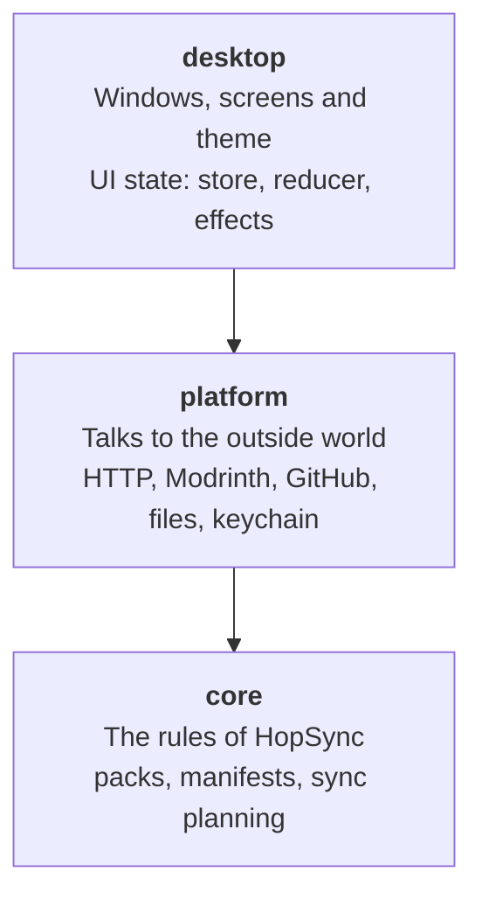
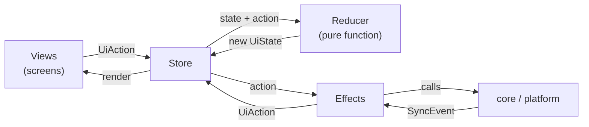
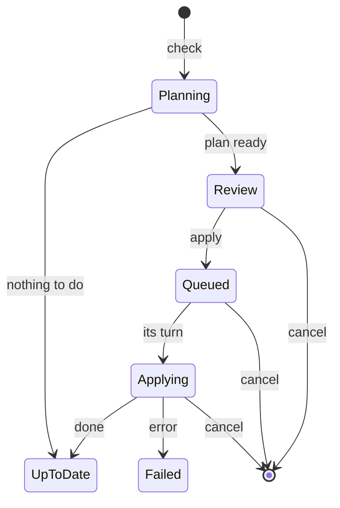

# HopSync

HopSync is a desktop app for Windows, macOS and Linux that keeps Minecraft modpacks in sync. A pack is a list of
mods and configs. Playing it with friends means everyone needs the same files, in the right versions, in the
right game folder. HopSync does that for you, and lets you build and share your own pack without touching a
server or a command line.

The interface is in English and Latin American Spanish. It follows the system language, and the player can
pick another one in HopSync settings.

## What it is for

Playing a modded server usually goes like this: the admin sends a zip or a list of mods, every player copies
files by hand, and each update starts again. Someone always ends up with a wrong version, a missing mod or an old
config.

HopSync replaces that with a **link**:

- **The person who makes the pack** publishes it once and gets a link.
- **Everyone else** pastes the link in HopSync and picks their game folder.
- **When the pack changes**, HopSync shows each player what changed. They apply it with one click.

HopSync only touches the files it installed. Mods you added yourself and configs you edited stay as they are.

## How it works

### Following a pack

1. **Add the pack.** Choose "Add pack", paste the link and pick the game folder. HopSync finds the
   official launcher's `.minecraft` and the instances of Prism Launcher, CurseForge and Modrinth App, or you
   can choose any other folder.
2. **Review.** HopSync compares the pack with what is in the folder. The pack header lists what will be added,
   updated or removed, and the download size. Nothing is written yet.
3. **Apply.** HopSync downloads the files in parallel and checks the size and SHA-512 hash of each one. It then
   moves each file into place in one step. You can cancel at any time.
4. **Stay up to date.** HopSync checks again when you ask, or every time it opens if "Buscar cambios al abrir"
   is on. If the pack changed, you
   review and apply again. Only what is missing or changed is downloaded.

You can follow several packs, each in its own folder. The same pack can also live in several instances.

### Creating and sharing your own pack

1. **Start from scratch.** In the wizard, choose "Empieza desde cero". Give the pack a name, a Minecraft
   version and a loader (Fabric, NeoForge, Forge or Quilt).
2. **Add mods.** Search the [Modrinth](https://modrinth.com/) catalog from the app. HopSync picks the newest
   version that fits your Minecraft version and loader, and adds the mods it requires too. You can also add
   jars of your own, change a mod's version, or remove it. Every change goes through the same review and apply
   as any other pack, so your own game folder always matches what you edit.
3. **Publish.** Connect your GitHub account in "Ajustes de HopSync › Cuenta" and choose "Publicar". The first
   time, HopSync creates a public repository in your account from a template. Each publish uploads the pack
   in one commit and waits for the repository's build to make the manifest. You then get the link to share.
4. **Publish changes.** After you edit the pack, HopSync shows "Publicar cambios". Your friends see the update
   the next time they check.

Each published repository has a README with the pack's link and a content notice. The mods belong to their
authors. HopSync is only the tool that installs the pack, and the person who publishes it is responsible for
having permission to share the files they add.

### Why updates are safe

- **Nothing changes before you review it.** Planning only reads. Writing starts when you apply.
- **HopSync remembers what it installed.** It keeps a record in `.hopsync/state.json` inside the game folder,
  with the hash, size and date of every file it put there. It only ever removes files from that record.
- **Your edits are kept.** A config you changed stays unless the pack marks it to always be replaced.
- **Every file is checked.** Downloads go to a temporary file first. They are checked against the size and
  hash in the pack before they replace anything.
- **Stopping is safe.** After a cancel, a failure or a closed window, the record still matches the disk.
  Retrying only fetches what is missing.
- **One pack per folder.** Two packs cannot share a folder, and one pack applies at a time.

### Where your data lives

| What | Where |
|------|-------|
| Settings, packs you follow, packs you created, logs | `%APPDATA%\HopSync`, `~/Library/Application Support/HopSync` or `~/.config/hopsync` |
| The record of installed files | `<game folder>/.hopsync/` |
| Your GitHub sign-in | The system keychain: Keychain on macOS, Credential Manager on Windows, Secret Service on Linux |

The GitHub token never goes into the settings file or the logs. HopSync asks only for the `public_repo`
permission, which lets it create and update public repositories. Removing a pack from HopSync never deletes
its game folder.

## The pack format

A published pack is a `manifest.json` (format 2) served over https, usually as a GitHub release asset. It lists
each mod and config with its download URL, size and SHA-512 hash.

A pack created in HopSync is stored as a `hopsync.toml` in its repository: the pack's details, its Modrinth
mods pinned to an exact version, and the folders `local-mods/` and `configs/`. The repository's build turns that
file into the `manifest.json`. See [hopsync-demo](https://github.com/JJGarciaMartinez/hopsync-demo) for the
schema and an example pack. Its link is the demo the wizard offers.

## Architecture

HopSync is a Java 21 Swing app, built with Gradle. It has three modules. Each module only depends on the ones
below it, and ArchUnit tests enforce this.



- **`core`** holds the domain: what a pack and a manifest are, how a sync is planned and run, and each pack's
  update lifecycle. It does not know about Swing, HTTP or files on a specific system. When it needs something
  from outside, it declares an interface (a *port*), such as `ModCatalog`, `SecretStore` or `PackPublisher`.
- **`platform`** implements those ports: downloads with retries and hash checks, the Modrinth API, publishing on
  GitHub, the native keychains through JNA, settings files, and finding game folders and launcher instances.
- **`desktop`** is the app the player sees, styled with FlatLaf and its own theme. `AppContainer` builds every
  service once and passes it where it is needed.

### How the screen updates

The UI follows a one-way data flow:



1. A click or a key press becomes a `UiAction`, such as "check this pack" or "apply".
2. The `Reducer` takes the current `UiState` and the action and returns the next state. It does nothing else,
   so it is easy to test.
3. The views draw the new state.
4. `Effects` does the slow work in the background: network, disk, keychain. It is the only part of the UI that
   calls the core. Results come back as new actions.

The core reports progress as `SyncEvent`s, for example "plan ready", "progress" or "update failed". Errors are
typed (`SyncFailure`), and only the desktop module turns them into text in the player's language with a
suggested action.

### Life of an update



Each pack has its own session. All packs share one queue, so only one pack writes files at a time.

## Project structure

```
core/        Domain: packs, manifests, the sync planner and executor, sessions, ports
platform/    Adapters: HTTP, Modrinth, GitHub, settings, keychains, game folders and instances
desktop/     The Swing app: screens, UI state, effects, theme kit, Main and packaging tasks
packaging/   Installer icons and the launchers of the portable ZIP
brand/       Brand sheet, design tokens, and the mark and logotype as SVG and PNG
scripts/     Helper scripts (for example, inspecting a built macOS .dmg)
```

## Development

You need Java 21. The Gradle wrapper downloads everything else (use `gradlew.bat` on Windows).

```bash
./gradlew build      # compile, run every test and build desktop/build/libs/HopSync.jar
./gradlew test       # tests only
./gradlew run        # launch the app from the sources
./gradlew jpackage   # native installer for the current system, in desktop/build/installer/
```

The compiler treats every warning as an error. CI builds and tests on Ubuntu, Windows and macOS for each pull
request. Pushing a version tag builds the three installers and drafts a GitHub Release.

More detail:

- [BUILD_GUIDE.md](BUILD_GUIDE.md): installers, the portable ZIP and releases.
- [VERSION_GUIDE.md](VERSION_GUIDE.md): the version scheme.
- [BRANCHING.md](BRANCHING.md): branches and pull requests.

## Brand

The visual identity is documented in [brand/BRAND.md](brand/BRAND.md): the mark "Tu caja", the palette "Tinta,
turquesa y coral", the type and the voice. Its tokens and assets are generated from the app's own theme and
drawing code (`./gradlew brandAssets`), so the app and the brand sheet never drift apart.

## Requirements

- **Installers** (`.msi`, `.dmg`, `.deb`): they bundle their own Java, so there is nothing else to install.
- **Portable ZIP**: Java 21 or newer, for example from [adoptium.net](https://adoptium.net/).
- An internet connection, and Minecraft installed with the pack's mod loader.
- To publish packs: a GitHub account.

## Verifying downloads

The installers are not code signed yet, so Windows SmartScreen and macOS Gatekeeper warn the first time they open.
Every release is built from this repository by the [release workflow](.github/workflows/release.yml) and ships a
`SHA256SUMS.txt` with the SHA-256 of each file. To check a download, compare its hash with the one in that file:

- Windows (PowerShell): `Get-FileHash .\HopSync-<version>.msi`
- macOS: `shasum -a 256 HopSync-<version>.dmg`
- Linux: `sha256sum -c SHA256SUMS.txt --ignore-missing` in the folder with the downloads

## Privacy

HopSync collects no personal data and sends nothing about you anywhere. It only connects to the services it needs,
listed in the [privacy policy](PRIVACY.md), and its check for newer versions can be turned off in Settings › General.

## License

HopSync is released under the [MIT License](LICENSE). The libraries, fonts and Java runtime it ships keep their
own licenses, listed in [THIRD-PARTY-NOTICES.md](THIRD-PARTY-NOTICES.md).
