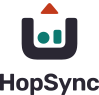
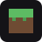
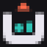
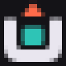
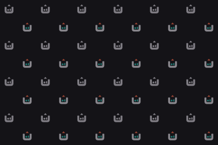

# HopSync · Hoja de marca

Esta es la fuente de verdad de la identidad de HopSync dentro del repo. Los colores, medidas y archivos de esta
carpeta salen del mismo código que pinta la app. `./gradlew brandAssets` regenera `tokens.json`, `svg/`, `png/` y
`pattern.svg`, y `./gradlew brandIcons` regenera los iconos de `packaging/`. Ninguno se edita a mano, y ningún
color, fuente ni icono se añade a la app fuera de `HopSyncDark.properties` y `kit/Palette`.

## 1. Plataforma

**Propósito.** Que cualquier persona pueda crear su modpack sin complicaciones, sin saber de versiones, loaders ni
carpetas ocultas.

**Para quién.** Quien juega con amigos y quiere sus mods, no aprender a instalarlos. Y quien ya sabe, pero está
cansado de hacerlo a mano para cada amigo.

**Promesa.** Eliges qué quieres; HopSync se encarga de que todo encaje y siga al día. Revisas antes de que cambie
nada, y nada se rompe por el camino.

**Personalidad.**

| Es | No es |
| --- | --- |
| Cercana | infantil |
| Clara | técnica |
| Creativa | gamer agresiva |
| Fiable | corporativa |

**Territorio.** Los launchers y gestores de mods se visten con la identidad de Minecraft: bloques, píxel, tierra y
hierba. HopSync tiene identidad propia: Minecraft aparece en el contenido (los mods, las capturas), nunca en la
marca.

**Voz.** Frases cortas en voz activa, con las palabras del jugador. El botón dice lo que pasa ("Aplicar cambios")
y el aviso lo confirma ("7 cambios aplicados"). Los errores dicen qué pasó y cómo arreglarlo, sin disculpas.

| Así habla un launcher | Así habla HopSync |
| --- | --- |
| Introduce la URL del manifest | Pega el enlace de tu pack |
| Crear nueva instancia | Crea tu pack |
| Sincronizando 77 artefactos | Bajando 77 mods |
| Instancia actualizada | Todo listo. Ya puedes jugar. |

Vocabulario fijo: **bajar** (nunca descargar ni sincronizar), **carpeta del juego** (nunca instancia),
**Todo listo** (nunca al día), **Esperando turno** (nunca en cola), **Quitar** (nunca eliminar).

## 2. Isotipo: Tu caja

Una caja abierta (la marca) que guarda lo que ya tienes (turquesa) mientras cae dentro una pieza nueva (coral).
Habla de lo que hace la app: todo lo tuyo, en orden, y lo nuevo encaja sin romper nada.

**Geometría.** Retícula de 32 unidades. Cada esquina es una curva cuadrática por el vértice, con el radio limitado
a media arista.

| Pieza | Papel | Forma | Radio |
| --- | --- | --- | --- |
| Caja | Marca | (2,9) (8,9) (8,24) (24,24) (24,9) (30,9) (30,30) (2,30) | 1.5, 1.5, 3, 3, 1.5, 1.5, 8, 8 |
| Círculo | Lo tuyo | centro (13,19), radio 3 | — |
| Cuadrado | Lo tuyo | (18,15) a (22,22) | 1.2 |
| Triángulo | Lo que llega | (16,1) (21,7) (11,7) | 1.4 |

**Versión pequeña, obligatoria a 24 px o menos.** La misma caja con una sola pieza dentro (cuadrado (11,13) a
(21,22), radio 2) y el triángulo (16,1) (21.5,8) (10.5,8). Ningún hueco baja de 2 unidades: 1 px a 16 px.

| Maestra | Pequeña |
| --- | --- |
|  |  |

**Icono de app.** Baldosa tinta de 32 unidades con radio 7.5 y un filo blanco al 10 %. La marca va a escala 0.625,
desplazada 6 unidades; en el icono de 16 px ocupa 0.8 de la baldosa para que sus huecos no bajen de 1 px.

**Zona de respeto:** 4 unidades alrededor (un octavo del ancho). **Tamaño mínimo:** 16 px en pantalla, 5 mm
impreso.

## 3. Variantes

| Variante | Cuándo | Archivo |
| --- | --- | --- |
| Color sobre oscuro | La app, el icono, fondos oscuros | `svg/mark-dark.svg` |
| Color sobre claro | Web, documentos, papel | `svg/mark-light.svg` |
| Una tinta, negro | Impresión de un color, sellos | `svg/mark-black.svg` |
| Negativo, blanco | Barras del sistema, fotos y vídeos | `svg/mark-white.svg` |
| Sobre el color de marca | Banners y merch: la marca en blanco | `svg/mark-white.svg` |

El volumen se dibuja con huecos, nunca con sombras: el fondo dibuja las aristas, así que la versión de una tinta y
el negativo son exactamente la misma forma. Cada variante existe también en versión pequeña (`svg/mark-small-*.svg`)
y en PNG de 16 a 512 px (`png/mark-<variante>-<px>.png`).

**Logotipo.** "HopSync" en Rubik SemiBold con un tracking de −0.025 em, convertido a contornos en los SVG.

| Horizontal | Apilado |
| --- | --- |
|  |  |

## 4. Usos incorrectos

| No | Por qué |
| --- | --- |
|  | Rotar o inclinar la marca. |
|  | Estirarla o aplastarla. |
|  | Cambiar el color de una pieza: cada color es un papel. |
|  | Añadir sombras, degradados o brillos a la marca. |
|  | Ponerla sobre un fondo con contraste menor de 3:1. |
|  | Volver a bloques, píxel o hierba. |
|  | Usar la versión grande por debajo de 25 px; a 16 px va la pequeña . |

## 5. Paleta: Tinta, turquesa y coral

Tres papeles: **tinta** es la caja (la marca y el fondo), **turquesa** es lo tuyo y **coral** es lo que llega.

| Color | Valor | Papel |
| --- | --- | --- |
| Tinta | `#141317` | Fondo de la app |
| Caja | `#E9E6EF` | La marca, títulos de marca, aviso flotante |
| Turquesa | `#2EC4B6` | Lo tuyo: progreso, Todo listo, foco, enlace válido |
| Coral | `#FF6B4A` | Lo que llega: acción principal, mods nuevos |
| Ámbar | `#F2B24A` | Mods que cambian de versión |
| Rosa | `#F2668B` | Quitar y errores, para no confundirse con el coral |

Sobre papel: papel `#F5F4F7`, caja `#2A2733`, turquesa `#0E7A71`, coral `#C23A1C`. La lista completa, con los
neutros y el relieve, está en `tokens.json`.

**Estados**, un color cada uno, siempre con icono y texto (nunca solo color):

| Estado | Color |
| --- | --- |
| Todo listo, completado | turquesa `#2EC4B6` |
| Cambios por revisar, aplicado con errores | ámbar `#F2B24A` |
| Buscando, bajando | coral `#FF6B4A` |
| Esperando turno | gris `#9D9AA6` |
| Error, sin conexión | rosa `#F2668B` |
| Sin comprobar, cancelado | gris tenue `#6E6B78` |

**Contraste medido (WCAG 2.1).** El texto necesita 4.5:1 y los iconos y formas 3:1.

| Par | Contraste |
| --- | --- |
| Texto `#EEECF2` sobre tinta | 15.8:1 |
| Caja sobre tinta | 15.0:1 |
| Turquesa sobre tinta | 8.5:1 |
| Ámbar sobre tinta | 9.9:1 |
| Coral sobre tinta | 6.6:1 |
| Rosa sobre tinta | 6.2:1 |
| Texto secundario `#9D9AA6` sobre tinta | 6.7:1 |
| Texto del botón principal `#2A0D05` sobre coral | 5.6:1 |
| Caja sobre papel | 13.3:1 |
| Coral `#C23A1C` sobre papel | 4.9:1 |
| Turquesa `#0E7A71` sobre papel | 4.7:1 |
| Texto tenue `#6E6B78` sobre tinta | 3.6:1, solo para texto desactivado o etiquetas que no son imprescindibles |

## 6. Tipografía

| Papel | Fuente | Pesos | Uso |
| --- | --- | --- | --- |
| Marca y títulos | Rubik | 600, 700 | Logotipo, nombre del pack, títulos de bienvenida y sheets |
| Interfaz | Figtree | 400, 500, 600 | Todo lo demás |
| Datos | JetBrains Mono | 400, 500 | Versiones, rutas, nombres de archivo |

Escala (px a escala 1x): título de bienvenida 25 / 600 · nombre del pack 23 / 600 · estado 14 / 600 · cuerpo
13 / 500 · secundario 12.5 / 400 · versión 11.5 mono. Las tres fuentes son OFL y van dentro del JAR con su
licencia. En el código, los tamaños son siempre relativos a la fuente de la interfaz y enteros en los estilos de
FlatLaf.

## 7. Interacción: tres alturas

El jugador tiene que saber qué se pulsa sin leer nada.

- **Elevado, se pulsa:** botones, el pack seleccionado y el segmento activo. Cara con degradado, borde más oscuro
  abajo y un bisel que se ve debajo (2 px; 3 px el principal). Hover sube la cara 1 px; pulsado la baja sobre el
  bisel. Radio 10 px, alto 36 px (38 px el principal). Botones de icono de 30 px (26 px en la cabecera de la
  biblioteca), radio 8.
- **Hundido, se escribe o se elige:** campos, buscador, carriles de segmentos y barras de progreso. Fondo
  `#0D0C10`, borde `#2B2932` con el borde de arriba `#050506` y una sombra interior de 4 px.
- **Plano, solo informa:** etiquetas, versiones, tamaños, rutas y cabeceras de grupo. Sin borde, sombra ni cursor
  de mano.

| Rol | Cara | Bisel | Texto |
| --- | --- | --- | --- |
| Principal | `#FF8A6B` → `#F2603F` | `#8A2711` | `#2A0D05`, negrita |
| Secundario | `#36333E` → `#2A2830` | `#08080A` | `#EEECF2` |
| Discreto | `#2A2830` → `#232128` | `#08080A` | `#9D9AA6`, `#EEECF2` en hover |
| Peligro | `#3A2229` → `#2E1B21` | `#170A0E` | `#F2668B` |

Reglas: el cursor de mano solo aparece en lo elevado, las filas, los packs y los enlaces. Todo lo interactivo
tiene hover, pulsado y un anillo de foco turquesa de 2 px. Un control desactivado pierde el relieve: se aplana
para decir "ahora no".

## 8. Movimiento

La única animación es la marca como indicador de carga: la pieza coral cae en la caja cada 1.5 s, con la curva
`cubic-bezier(.55, 0, .75, 1)`. Entra con un fundido en el primer 25 % del ciclo, llega abajo al 60 % y se
desvanece en el último 15 %. Solo se mueve en las esperas largas, que son la cabecera del pack mientras busca o
baja mods. La biblioteca, las filas y la bienvenida llevan la marca quieta.

Con **Reducir animaciones** (Ajustes de HopSync) la marca se queda quieta en todas partes.

## 9. Iconografía y patrón

**Iconos de interfaz.** Dibujados con Java2D sobre una retícula de 16 unidades, trazo de 1.5, puntas y uniones
redondeadas (`kit/Icons`). Escalan solos en pantallas HiDPI. No se usan iconos de mapa de bits.

**Insignias de estado.** La silueta pequeña de Tu caja, a una tinta en el color del estado, sobre una baldosa de
36 px: es como cada pack muestra su estado en la biblioteca.

**Patrón.** La marca repetida en una baldosa de 72 px: una en el color de la caja al 50 % y otra en color al 55 %,
sobre tinta. Para el instalador, la web o el fondo de un directo.

